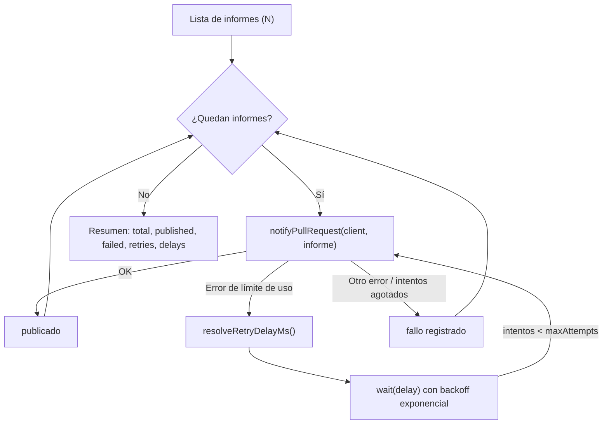

# Publicación continua y límites de uso (HU08 - T5) ♾️

Este documento recoge la comprobación de que la publicación de informes funciona de forma
continua y **no impone límites de uso propios**, junto con la estrategia para convivir con los
límites reales de la API de GitHub.

- **Historia de Usuario**: HU08 — Comunicación eficiente de resultados
- **Tarea**: HU08-T05 — Comprobar que la publicación funciona de forma continua y no impone límites de uso
- **Responsable**: Germán Peláez Gallardo (GG)
- **Revisor**: Candela Marco Jiménez (CJ)

---

## 1. Alcance de la tarea

La tarea es de **verificación y endurecimiento** de la publicación ya implementada en HU08-T03
(`src/reporter/pr-notifier.js`). No se rediseña el formato del informe ni se duplica la gestión
general de errores de HU08-T04; aquí solo se comprueba y se garantiza que:

1. La Action **no limita** el número de informes que publica: recibe N informes y publica los N.
2. El uso sostenido (muchas publicaciones seguidas) **no introduce esperas artificiales**.
3. Cuando GitHub aplica un **límite de uso**, la publicación se reanuda respetando las cabeceras
   que devuelve la API, en lugar de fallar o detenerse el servicio.
4. Un fallo aislado en un informe **no interrumpe** el resto de publicaciones.

---

## 2. Límites reales de GitHub (contexto)

| Límite                                        | Valor                                              | Fuente                    |
| --------------------------------------------- | -------------------------------------------------- | ------------------------- |
| `GITHUB_TOKEN` en GitHub Actions              | 1.000 peticiones/hora por repositorio              | `x-ratelimit-limit`       |
| Token personal / instalación de GitHub App    | 5.000 peticiones/hora                              | cabeceras `x-ratelimit-*` |
| Peticiones concurrentes                       | máximo 100 simultáneas                             | límite secundario         |
| Puntos por minuto (REST)                      | 900 puntos/min (`GET` = 1 punto, `POST/PATCH` = 5) | límite secundario         |
| **Creación de contenido**                     | 80/minuto y 500/hora                               | límite secundario         |
| Espera sin `retry-after` en límite secundario | **al menos 60 segundos**                           | límite secundario         |

Consecuencia práctica: publicar un informe cuesta **2 peticiones** (un `GET` para localizar el
comentario previo y un `POST`/`PATCH` para crear o actualizar). Es decir, la cuota de creación de
contenido permite del orden de **500 informes nuevos por hora**; por encima de eso GitHub devuelve
`403`/`429` y hay que esperar.

> La Action **no añade** ningún tope por debajo de esos valores: si el usuario tiene cuota, publica.

---

## 3. Estrategia implementada

Módulo: `src/reporter/publication-limits.js`



### A. Sin tope propio

`publishContinuously()` recorre la lista completa de informes. No existe ningún `slice`, contador
máximo ni pausa entre publicaciones correctas: un test publica **150 informes** y verifica que
`wait()` no se invoca ni una sola vez.

### B. Detección del límite de uso

`isRateLimitError()` reconoce los tres casos documentados por GitHub y descarta falsos positivos:

- `429` (siempre es límite de uso).
- `403` con mensaje de _rate limit_ / _secondary rate limit_ / _abuse detection_.
- `403` con `x-ratelimit-remaining: 0` o con cabecera `retry-after`.
- **No** se confunde un `403` de permisos (`Resource not accessible by integration`) ni un `500`.

### C. Espera respetando a GitHub

`resolveRetryDelayMs()` aplica esta prioridad:

1. `retry-after` en segundos o como fecha HTTP.
2. `x-ratelimit-reset` (epoch en segundos) menos la hora actual.
3. Límite secundario sin cabeceras → **mínimo 60 s**.
4. Cualquier otro caso → retardo por defecto (1 s).

El resultado se acota entre 0 y `maxRetryDelayMs` (2 min por defecto) para no bloquear el runner
durante horas si la ventana de cuota tarda en reiniciarse.

### D. Backoff exponencial

Entre reintentos el retardo se duplica (`1 s`, `2 s`, `4 s`, …) hasta el máximo configurado, tal y
como recomienda GitHub cuando un límite secundario persiste.

### E. Aislamiento por informe

Cada informe se procesa de forma independiente: si uno agota sus intentos, se registra como
`failed` y se continúa con el siguiente. Así una PR problemática no bloquea la publicación de las
demás.

---

## 4. API del módulo

| Función                                         | Descripción                                                        |
| ----------------------------------------------- | ------------------------------------------------------------------ |
| `isRateLimitError(error)`                       | Indica si el error corresponde a un límite de uso de GitHub.       |
| `resolveRetryDelayMs(error, options)`           | Calcula la espera en ms según `retry-after` / `x-ratelimit-reset`. |
| `publishContinuously(client, reports, options)` | Publica todos los informes con reintentos y devuelve un resumen.   |

Opciones de `publishContinuously`: `publish` (por defecto `notifyPullRequest`), `wait`, `maxAttempts`
(4 por defecto), `retryDelayMs`, `maxRetryDelayMs` y `now` (reloj inyectable en pruebas).

Resumen devuelto:

```json
{
  "total": 150,
  "published": 150,
  "failed": 0,
  "retries": 0,
  "delays": [],
  "results": [{ "index": 0, "status": "published", "attempts": 1, "result": {} }]
}
```

---

## 5. Verificación (TDD)

Pruebas: `tests/publication-limits.test.js` (24 casos).

```bash
npx jest tests/publication-limits.test.js
npm test
npm run lint
```

| Comprobación                      | Caso de prueba                                  |
| --------------------------------- | ----------------------------------------------- |
| No hay tope propio                | 150 informes publicados, 0 esperas              |
| Publicación real integrada        | `notifyPullRequest` crea el comentario en el PR |
| Límite primario 429/403           | Reintenta y termina publicando                  |
| `retry-after` en segundos y fecha | Espera calculada correctamente                  |
| `x-ratelimit-reset`               | Espera calculada y nunca negativa               |
| Límite secundario sin cabeceras   | Espera mínima de 60 s                           |
| Backoff exponencial               | `[1000, 2000, 4000]` ms                         |
| Intentos agotados                 | Marca `failed` y sigue con el resto             |
| Error no relacionado con cuota    | No reintenta                                    |
| `403` de permisos                 | No se trata como límite de uso                  |

---

## 6. Conclusión

La publicación queda verificada como **continua y sin límites propios**: el número de informes no
está acotado por la Action, no se introducen esperas en el camino feliz y los límites de GitHub se
absorben con reintentos que respetan sus cabeceras. El único límite efectivo es la cuota de la API,
que la Action no puede (ni debe) eludir.

---

## Referencias

- [Rate limits for the REST API](https://docs.github.com/en/rest/using-the-rest-api/rate-limits-for-the-rest-api)
- [Best practices for using the REST API](https://docs.github.com/en/rest/using-the-rest-api/best-practices-for-using-the-rest-api)
