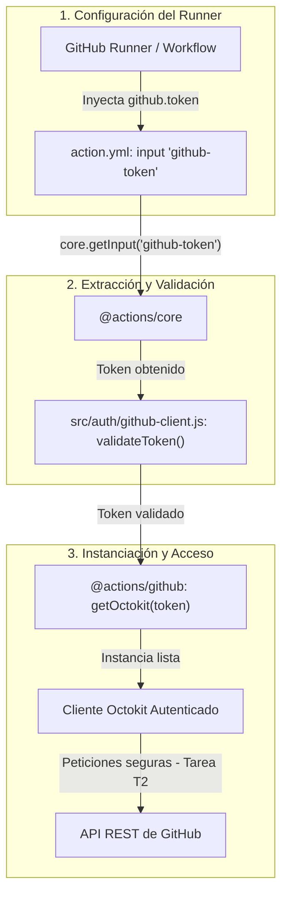

# Estrategia de Autenticación con la API de GitHub 🔐

Este documento describe el mecanismo de autenticación utilizado por la GitHub Action **AI Authorship & Quality Gate Action**, cómo se obtienen las credenciales del usuario y cómo se inicializa el cliente de Octokit de forma segura.

---

## 1. Visión General del Flujo de Autenticación

El proceso de autenticación sigue un flujo en tres capas:



---

## 2. Obtención del Token con `@actions/core`

El paquete oficial **[`@actions/core`](https://github.com/actions/toolkit/tree/main/packages/core)** proporciona las utilidades para interactuar con el entorno de ejecución de GitHub Actions.

### A. Configuración en `action.yml`

En `action.yml` definimos el input `github-token`. Por defecto toma `${{ github.token }}`, que es el token efímero que GitHub crea para cada ejecución del flujo de trabajo:

```yaml
inputs:
  github-token:
    description: 'Token de GitHub para autenticación y llamadas a la API (Octokit)'
    required: true
    default: ${{ github.token }}
```

### B. Lectura en código

Para recuperar el valor del token en tiempo de ejecución:

```javascript
const core = require('@actions/core');

// Obtiene el token pasado como input (o su valor por defecto)
const token = core.getInput('github-token', { required: true });
```

> **Buenas prácticas de seguridad con `@actions/core`:**
>
> - Si el token se proporciona dinámicamente o proviene de una fuente externa, debe registrarse con `core.setSecret(token)` para que el runner lo enmascare automáticamente con `***` en cualquier salida de consola.

---

## 3. Autenticación e Inicialización con `@actions/github`

El paquete oficial **[`@actions/github`](https://github.com/actions/toolkit/tree/main/packages/github)** es el SDK estándar para interactuar con la API REST y GraphQL de GitHub dentro de Actions.

### A. Creación del cliente Octokit

Para autenticar las peticiones usamos `github.getOctokit(token)`:

```javascript
const github = require('@actions/github');

// Inicializa el cliente Octokit con el token
const octokit = github.getOctokit(token);
```

### B. Ventajas de usar `github.getOctokit` frente al cliente Octokit básico:

1. **Configuración automática del runner**: Configura automáticamente los headers de GitHub Actions (como el `User-Agent` del runner).
2. **Contexto integrado**: Se integra nativamente con `github.context`, facilitando el acceso a datos como `owner`, `repo`, `issue_number` o `sha`.
3. **Soporte para plugins y opciones**: Permite pasar configuraciones avanzadas de reintentos, plugins y throttling, lo cual servirá de base para la tarea **T2** (llamadas seguras a la interfaz) y **T4** (gestión de errores y reintentos).

---

## 4. Arquitectura del Módulo (`src/auth/github-client.js`)

Para cumplir con los principios de diseño de software y facilitar las pruebas unitarias (**TDD**):

- No invocamos `github.getOctokit` ni `core.getInput` de forma dispersa por la aplicación.
- Centralizamos la lógica en el módulo `src/auth/github-client.js`:

```javascript
const core = require('@actions/core');
const github = require('@actions/github');

/**
 * Valida un token de GitHub.
 * @param {*} token
 * @throws {Error} Si el token no es un string o está vacío.
 */
function validateToken(token) {
  if (typeof token !== 'string' || token.trim() === '') {
    throw new Error('GitHub token es requerido y debe ser una cadena válida no vacía.');
  }
}

/**
 * Resuelve el token: usa el proporcionado o lo lee del input de la Action.
 * Solo `undefined` significa "no proporcionado"; `null` y la cadena vacía
 * se conservan para que la validación los rechace explícitamente.
 */
function resolveToken(token) {
  if (token === undefined) {
    return core.getInput('github-token', { required: true });
  }
  return token;
}

/**
 * Crea e inicializa un cliente Octokit autenticado.
 * @param {string} [token] - Token de GitHub opcional.
 * @param {object} [options] - Opciones adicionales de configuración para Octokit.
 * @returns {object} Instancia de Octokit autenticada.
 */
function createGitHubClient(token, options = {}) {
  const resolvedToken = resolveToken(token);
  validateToken(resolvedToken);

  const clientOptions = options === undefined || options === null ? {} : options;
  if (typeof clientOptions !== 'object' || Array.isArray(clientOptions)) {
    throw new Error('Las opciones de Octokit deben ser un objeto válido.');
  }

  core.setSecret(resolvedToken);
  return github.getOctokit(resolvedToken, clientOptions);
}

module.exports = {
  createGitHubClient,
  resolveToken,
  validateToken,
};
```

La diferencia entre `undefined`, `null` y la cadena vacía es intencionada: solo
`undefined` significa que el llamador no ha proporcionado token y se recurre al
input de la Action. `null` y la cadena vacía se consideran tokens inválidos
explícitos y se rechazan en lugar de sustituirse silenciosamente.

---

## 5. Estrategia de Pruebas y Depuración (Testing & Debugging)

Para validar el funcionamiento del cliente y las llamadas a la API sin depender de que exista una Pull Request real o un flujo en ejecución continua, combinamos **pruebas automatizadas con mocks** y **scripts de depuración local**:

### A. Pruebas automatizadas con Mocks (Jest)

Seguiremos utilizando **mocks** en los tests unitarios con Jest para aislar el código:

- Verificamos que la función valida correctamente los tokens y lanza excepciones defensivas ante valores nulos, indefinidos o vacíos.
- Comprobamos que se invoca `github.getOctokit(token)` con las opciones adecuadas sin realizar peticiones de red en cada ejecución de la suite.
- En fases posteriores (como la tarea T2), los mocks nos permitirán simular respuestas de la API (`octokit.rest.pulls.*`) sin requerir un repositorio remoto ni conexión a internet en el entorno de CI.

### B. Depuración local para conocer el formato real de Octokit

El principal problema al trabajar exclusivamente con mocks es no conocer con exactitud la estructura y los campos reales de los objetos devueltos por Octokit (por ejemplo, cómo vienen estructurados los autores, mensajes de commit o los diffs). Para tener una referencia fiel y debugear nosotros mismos:

1. **Script de depuración local (`scripts/debug-api.js`)**:
   Podemos ejecutar un script puntual en local con un token de desarrollo para imprimir en la terminal la respuesta real de la API de GitHub:

   ```javascript
   const github = require('@actions/github');

   async function debug() {
     const token = process.env.GITHUB_TOKEN || 'tu_token_aqui';
     const octokit = github.getOctokit(token);

     // Ejemplo: consultar los commits de una PR real para ver sus metadatos
     const { data } = await octokit.rest.pulls.listCommits({
       owner: 'tu-organizacion',
       repo: 'Proyecto-GPS',
       pull_number: 1,
     });

     console.log('Estructura real devuelta por Octokit:');
     console.log(JSON.stringify(data[0], null, 2));
   }

   debug();
   ```

2. **Uso de Fixtures reales para alimentar los Mocks**:
   El JSON extraído con el script de depuración se puede almacenar en una carpeta de muestras (`tests/fixtures/pr-commits.json`). Así, los mocks de Jest devuelven exactamente esa misma estructura real, permitiendo probar la lógica de negocio y depurar errores sin sorpresas de formato cuando el código corra en producción.

---

## 6. Referencias Oficiales

- Repositorio del SDK de GitHub Actions: [`@actions/github`](https://github.com/actions/toolkit/tree/main/packages/github)
- Repositorio del Core de GitHub Actions: [`@actions/core`](https://github.com/actions/toolkit/tree/main/packages/core)
- Documentación de la API REST de Octokit: [octokit.github.io/rest.js](https://octokit.github.io/rest.js/)
